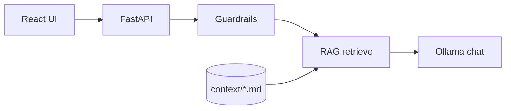

# Acme Widgets RAG Chatbot

Minimal **React** frontend + **FastAPI** backend with:

| Piece | Implementation |
|--------|----------------|
| **LLM** | [Ollama](https://ollama.com) — free, local, open weights (default: `llama3.2`) |
| **Embeddings** | `sentence-transformers` (`all-MiniLM-L6-v2`, runs locally) |
| **RAG** | Markdown files in `backend/context/` → chunked → cosine similarity retrieval |
| **Guardrails** | Input length + prompt-injection patterns; system prompt scoped to KB; output redaction |

The sample knowledge base is a short fictional “Acme Widgets” support doc so you can try RAG without hunting for data.

## Prerequisites

1. **Python 3.15** (see repo `.python-version`; use `pyenv`, `uv`, or [python.org](https://www.python.org/downloads/))
2. **Node.js 24 LTS** (see `.nvmrc` / `.node-version` — e.g. `nvm install` in the repo root)
3. **Ollama** installed and running:
   ```bash
   ollama pull llama3.2
   ```

## Backend

```bash
cd backend
python3.15 -m venv .venv
source .venv/bin/activate   # Windows: .venv\Scripts\activate
pip install -U pip
pip install -r requirements.txt
cp .env.example .env        # optional

On **Python 3.15**, use these pins (especially `pydantic>=2.14`); older pydantic versions try to compile `pydantic-core` from source and often fail.
uvicorn main:app --reload --port 8000
```

First start downloads the embedding model (~90MB). Check: [http://127.0.0.1:8000/health](http://127.0.0.1:8000/health)

## Frontend

```bash
cd frontend
nvm use          # optional, if you use nvm — selects Node 24 from ../.nvmrc
npm install
npm run dev
```

Open [http://localhost:5173](http://localhost:5173). Vite proxies `/api/*` → `http://127.0.0.1:8000`.

To point at another API host:

```bash
VITE_API_URL=http://127.0.0.1:8000 npm run dev
```

## Customize context

Edit or add `.md` files under `backend/context/` and restart the API (embeddings are built at startup).

## API

- `GET /health` — Ollama + index size
- `POST /chat` — `{ "message": "..." }` → `{ "reply", "sources" }`

## Architecture


