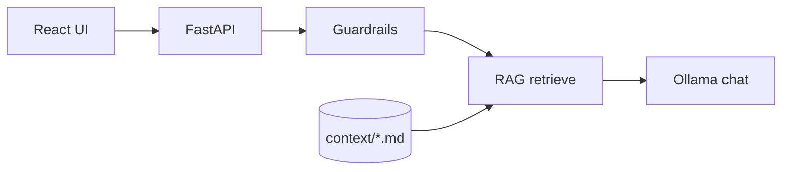
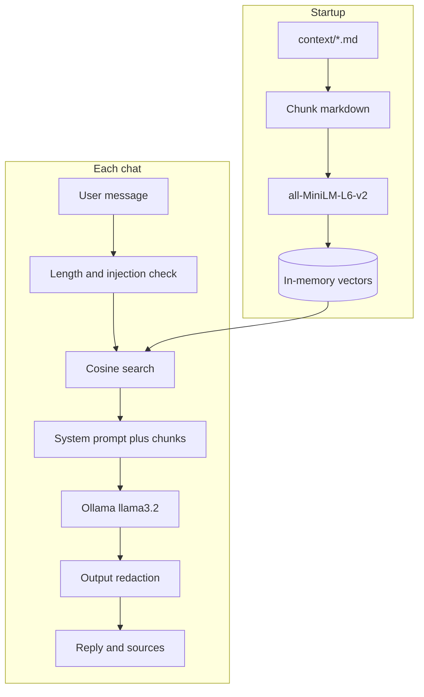

# Acme Widgets RAG Chatbot

Minimal **React** frontend + **FastAPI** backend with:

| Piece | Implementation |
|--------|----------------|
| **LLM** | [Ollama](https://ollama.com) — free, local, open weights (default: `llama3.2`) |
| **Embeddings** | `sentence-transformers` (`all-MiniLM-L6-v2`, runs locally) |
| **RAG** | Markdown files in `backend/context/` → chunked → cosine similarity retrieval |
| **Guardrails** | Input length + prompt-injection patterns; system prompt scoped to KB; output redaction |

The sample knowledge base is a short fictional “Acme Widgets” support doc so you can try RAG without hunting for data.

## Prerequisites

1. **Python 3.15** (see repo `.python-version`; use `pyenv`, `uv`, or [python.org](https://www.python.org/downloads/))
2. **Node.js 24 LTS** (see `.nvmrc` / `.node-version` — e.g. `nvm install` in the repo root)
3. **Ollama** installed and running:
   ```bash
   ollama pull llama3.2
   ```

## Backend

```bash
cd backend
python3.15 -m venv .venv
source .venv/bin/activate   # Windows: .venv\Scripts\activate
pip install -U pip
pip install -r requirements.txt
cp .env.example .env        # optional

On **Python 3.15**, use these pins (especially `pydantic>=2.14`); older pydantic versions try to compile `pydantic-core` from source and often fail.
uvicorn main:app --reload --port 8000
```

First start downloads the embedding model (~90MB). Check: [http://127.0.0.1:8000/health](http://127.0.0.1:8000/health)

## Frontend

```bash
cd frontend
nvm use          # optional, if you use nvm — selects Node 24 from ../.nvmrc
npm install
npm run dev
```

Open [http://localhost:5173](http://localhost:5173). Vite proxies `/api/*` → `http://127.0.0.1:8000`.

To point at another API host:

```bash
VITE_API_URL=http://127.0.0.1:8000 npm run dev
```

## Customize context

Edit or add `.md` files under `backend/context/` and restart the API (embeddings are built at startup).

## API

- `GET /health` — Ollama + index size
- `POST /chat` — `{ "message": "..." }` → `{ "reply", "sources" }`

## Architecture



Indexing happens once at startup. Each chat turn only searches that index, then asks the model to phrase an answer from the hits.



## Why this, not that

Goal: simple, free, trustworthy, with RAG, embeddings, and guardrails.

### React UI

**Chosen:** React + Vite  
**Over:** Next.js, Vue, plain HTML/JS

React is familiar, Vite is fast to run locally, and a chat UI doesn’t need SSR, routing, or a full framework. Next.js would add complexity with little benefit for a demo API-backed chat.

### FastAPI

**Chosen:** FastAPI  
**Over:** Flask, Django, Express-only backend

FastAPI gives async (good for calling Ollama over HTTP), automatic OpenAPI docs, and Pydantic validation with little boilerplate. Flask is fine but more manual; Django is heavier than needed for two endpoints.

### Guardrails (custom, lightweight)

**Chosen:** Length limits, regex for injection-ish input, scoped system prompt, light output redaction  
**Over:** NeMo Guardrails, Llama Guard, OpenAI Moderation API, full policy engines

Those tools are stronger but add dependencies, config, and often another model or paid API. For a small support bot on a fixed knowledge base, rules plus a strict system prompt get most of the value without a second LLM call.

### RAG retrieve (in-process, cosine similarity)

**Chosen:** Chunk markdown, then sentence-transformers embeddings, then in-memory cosine search  
**Over:** Pinecone, Weaviate, Chroma, LangChain, hosted embedding APIs

Local embeddings and a numpy dot product work fine for one small `context/*.md` file. A vector database shines at large scale and frequent updates; it’s extra moving parts for a toy knowledge base. Skipping LangChain keeps the pipeline readable in a few files (`rag.py`, `main.py`).

### Embeddings: all-MiniLM-L6-v2

**Chosen:** Small local Sentence Transformer  
**Over:** OpenAI `text-embedding-3-*`, larger models like `e5-large`

Free, runs offline, small download, fast on CPU — enough for short support docs. Cloud embeddings need keys, cost, and network. Bigger local models are slower for minimal gain on a tiny corpus.

### Knowledge base: markdown in `backend/context/`

**Chosen:** Plain `.md` on disk  
**Over:** PDF crawl, Confluence, SQL, S3 pipelines

Markdown is easy to edit, diff, and version. It matches “easy context” for a demo. Production often needs connectors; that’s intentionally out of scope here.

### Ollama (local llama3.2)

**Chosen:** Ollama on your machine  
**Over:** OpenAI, Anthropic, Groq, Hugging Face Inference, running raw llama.cpp yourself

Free and no API key for local dev; Ollama handles model pull, serving, and the chat API. Hosted APIs are simpler to operate but cost money and send data off-box. Raw llama.cpp is more DIY than `ollama pull` plus HTTP chat.

### LLM role vs RAG role

**Chosen:** RAG for facts, LLM for fluent answers constrained by context  
**Over:** LLM-only (no RAG), or retrieval-only templates with no LLM

LLM-only drifts and invents prices and policies. Template-only answers feel brittle. RAG plus an “answer only from context” prompt is the usual small-team pattern: retrieval grounds, the LLM phrases.

### What we’d swap first if requirements changed

| If you need… | Likely change |
| --- | --- |
| Bigger docs / many files | Chroma or a similar vector store |
| Stronger safety / categories | A moderation model or a guardrails framework |
| No local GPU/RAM for the LLM | Groq or OpenAI behind an env-based `llm.py` adapter |
| Production auth, rate limits | API gateway or middleware in FastAPI, not a UI-only sketch |
